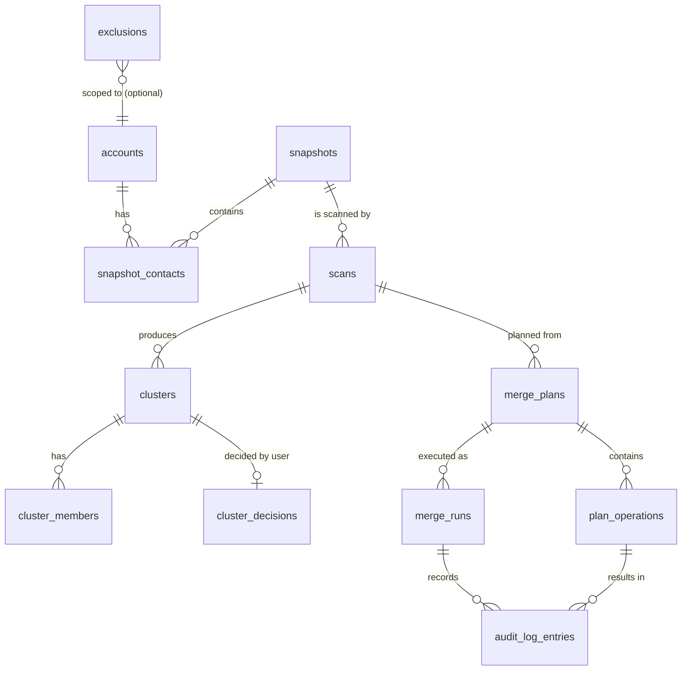

# Data model

Two layers:

1. **Domain model** — TypeScript types in `@contact-fuse/core`. Provider-agnostic, used by all logic.
2. **Persistence model** — SQLite tables in `apps/server/src/db/schema.ts` (Drizzle). Follows the
   [database standard](../standards/database.md): snake_case plural tables, text IDs (UUIDv7),
   ISO-8601 `created_at` / `updated_at`.

Terms are defined in the [glossary](../product/glossary.md).

## Domain model (core)

```ts
interface ContactRef {
  accountId: string; // connected account
  resourceId: string; // provider ID, e.g. Google "people/c123"
  version?: string; // provider version stamp (Google etag)
}

interface LabeledValue {
  value: string;
  label?: string;
}

interface Contact {
  ref: ContactRef;
  displayName?: string;
  givenName?: string;
  familyName?: string;
  emails: LabeledValue[];
  phones: LabeledValue[];
  organization?: string;
  birthday?: string; // ISO date, year optional ("--05-14")
  notes?: string;
  groups: string[]; // label/group names
  updatedAt?: string; // ISO timestamp if provider reports it
}
```

Derived types (planned, `packages/core/src/model/`):

| Type                | Meaning                                                                          |
| ------------------- | -------------------------------------------------------------------------------- |
| `NormalizedContact` | `Contact` + normalised keys: E.164 phones, lowercased emails, folded name tokens |
| `Match`             | `{ a: ContactRef; b: ContactRef; score: number; reasons: MatchReason[] }`        |
| `Cluster`           | `{ id; members: ContactRef[]; confidence: "high" \| "medium" \| "low"; score }`  |
| `MergeRules`        | per-field strategy: `prefer-main` \| `newest` \| `most-complete` \| `union`      |
| `CleanupPolicy`     | `keep` \| `label` \| `delete`                                                    |
| `MergePlan`         | ordered `PlanOperation[]` + summary counts                                       |
| `PlanOperation`     | `create` \| `update` \| `add-label` \| `delete` with target ref and payload      |

Fields not modelled (photos, custom fields, addresses in v1) are **preserved** by providers: an update
only touches the fields contact-fuse manages (Google `updatePersonFields`), so unknown data is not lost.
Addresses, URLs and relations are planned for v1.x.

## Entity relationship



## Tables

This is the **authoritative column list**. Tables marked _(M2+)_ are not created yet. The M1 tables (`accounts`, `snapshots`, `snapshot_contacts`, `settings`) are implemented in `apps/server/src/db/schema.ts`.

| Table               | Purpose                                                        | Key columns                                                                                                                                                                                                                                                                   |
| ------------------- | -------------------------------------------------------------- | ----------------------------------------------------------------------------------------------------------------------------------------------------------------------------------------------------------------------------------------------------------------------------- |
| `accounts`          | Connected accounts                                             | `id`, `provider` (`google`), `provider_account_id` (Google `sub`), `email`, `display_name`, `is_main` (partial unique: at most one), `status` (`connected` \| `needs-reauth` \| `disconnected`), `granted_scopes`, `sync_token`, `last_synced_at`, `created_at`, `updated_at` |
| `snapshots`         | One full backup of all accounts                                | `id`, `status` (`running` \| `completed` \| `failed`), `contact_count`, `account_count`, `error_code`, `created_at`, `completed_at`                                                                                                                                           |
| `snapshot_contacts` | Raw + canonical copy of every contact at snapshot time         | `id`, `snapshot_id` (cascade), `account_id` (restrict), `resource_id`, `etag`, `source` (`contacts` \| `other-contacts`), `raw_json` (provider payload, for exact restore), `contact_json` (canonical), `created_at`                                                          |
| `scans`             | One matching run                                               | `id`, `snapshot_id`, `settings_json`, `engine_version`, `status`, `cluster_count`                                                                                                                                                                                             |
| `clusters`          | Candidate duplicates                                           | `id`, `scan_id`, `score`, `confidence`                                                                                                                                                                                                                                        |
| `cluster_members`   | Contacts in a cluster                                          | `cluster_id`, `snapshot_contact_id`, `role` (`member` \| `removed-by-user`)                                                                                                                                                                                                   |
| `cluster_decisions` | User review result                                             | `cluster_id`, `decision` (`approve` \| `reject` \| `skip`), `field_overrides_json`                                                                                                                                                                                            |
| `exclusions`        | Never-merge rules                                              | `id`, `kind` (`contact` \| `label` \| `pair`), `account_id?`, `value`                                                                                                                                                                                                         |
| `merge_plans`       | Dry-run output                                                 | `id`, `scan_id`, `main_account_id`, `rules_json`, `cleanup_policy`, `status` (`draft` \| `applied` \| `stale`)                                                                                                                                                                |
| `plan_operations`   | Ordered operations                                             | `id`, `merge_plan_id`, `seq`, `kind`, `account_id`, `resource_id?`, `expected_etag?`, `payload_json`                                                                                                                                                                          |
| `merge_runs`        | Execution of a plan                                            | `id`, `merge_plan_id`, `status`, `started_at`, `finished_at`, `succeeded`, `skipped`, `failed`, `undo_of_run_id?`                                                                                                                                                             |
| `audit_log_entries` | Append-only record of every write                              | `id`, `merge_run_id`, `plan_operation_id`, `outcome` (`succeeded` \| `skipped-conflict` \| `failed`), `before_json`, `after_json`, `new_resource_id?`, `error_code?`, `created_at`                                                                                            |
| `settings`          | Key/value settings, each value validated by its own Zod schema | `key`, `value_json`, `updated_at`                                                                                                                                                                                                                                             |

### Invariants

- `audit_log_entries` is **append-only**. Undo creates a new run (`undo_of_run_id`) with its own entries.
- Every write to a provider has an audit entry written **before** the next operation starts.
- Exactly one account has `is_main = true` while a plan is being built or executed.
- A plan becomes `stale` if a newer snapshot exists for any involved account; stale plans cannot be
  applied without re-validation (etag check still protects each write).
- Raw provider payloads are stored so undo can restore exactly, not just the canonical subset.

## Storage location and sensitivity

The SQLite file lives in the OS app-data directory (`env-paths`), e.g.
`~/Library/Application Support/contact-fuse/contact-fuse.sqlite` on macOS; overridable with
`CONTACT_FUSE_DATA_DIR`. It contains personal data — see [security and privacy](security-and-privacy.md)
for permissions, retention and deletion. OAuth tokens are **never** stored in SQLite.
