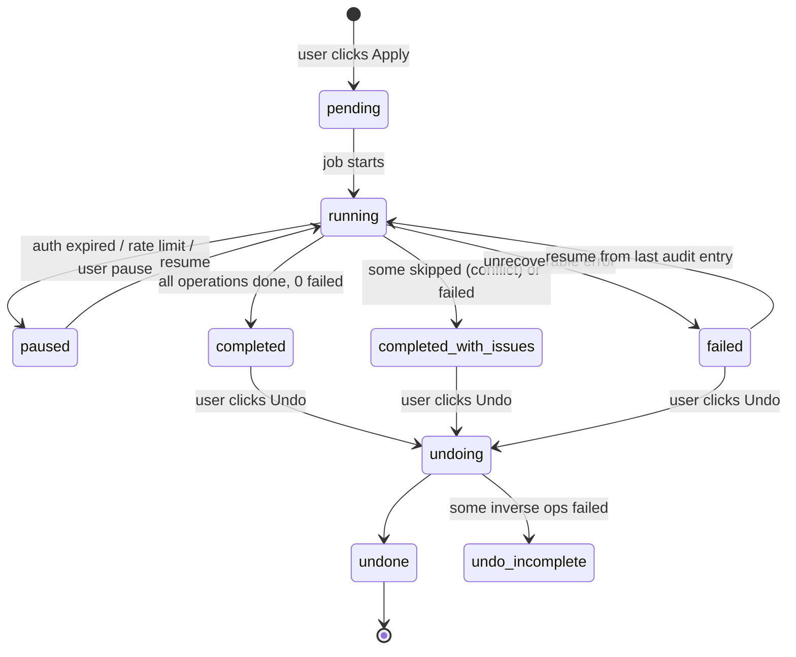

# Merge engine

The merge engine turns **approved clusters** into a **merge plan**, shows it as a **dry run**, executes
it as a **run** with a full **audit log**, and can **undo** it. Planning is pure (`packages/core/src/merge`);
execution is in `apps/server/src/services/run-service.ts`. Principles are fixed by
[ADR 0008](../adr/0008-safety-first-merge-model.md).

## Merge rules

Each field has a strategy. Defaults are shown; users can change every row.

| Field                       | Default                                               | Options                                  |
| --------------------------- | ----------------------------------------------------- | ---------------------------------------- |
| Name (given/family/display) | `prefer-main`                                         | `prefer-main`, `newest`, `most-complete` |
| Phones                      | `union` (deduplicated by E.164)                       | `union`, `prefer-main`, `newest`         |
| Emails                      | `union` (deduplicated by normalised value)            | `union`, `prefer-main`, `newest`         |
| Organisation                | `most-complete`                                       | all four                                 |
| Birthday                    | `most-complete` (full date beats month-day)           | `prefer-main`, `newest`, `most-complete` |
| Notes                       | `union` (joined with a separator, duplicates removed) | `union`, `prefer-main`, `newest`         |
| Labels/groups               | `union` (mapped by name into the main account)        | `union`, `prefer-main`                   |

- `prefer-main`: value from the main-account member if present, else falls through to `most-complete`.
- `newest`: value from the member with the latest `updatedAt`; ties → `prefer-main`.
- `most-complete`: longest/most specific non-empty value.
- `union`: all distinct values; labels (`mobile`, `work`) kept; first value is the main-account one.

Users can override any field per cluster in the review screen (`cluster_decisions.field_overrides_json`).
Overrides beat rules.

## Building the survivor

For each approved cluster:

1. **Target**: if the cluster has a member in the main account, that member is the survivor target
   (`update`). If it has several (duplicates within the main account), the most recently updated one
   is the target and the others become _redundant main members_. If none, a new contact is `create`d
   in the main account.
2. Apply merge rules + overrides to produce the survivor `Contact`.
3. If the survivor equals the target's current state, emit no update (idempotent).

## Plan operations

| Operation                            | Account | When                                                                                                   |
| ------------------------------------ | ------- | ------------------------------------------------------------------------------------------------------ |
| `create`                             | main    | Cluster has no main-account member                                                                     |
| `update`                             | main    | Survivor differs from target; carries `expected_etag`                                                  |
| `add-label`                          | main    | Survivor needs labels from source accounts                                                             |
| `delete`                             | main    | Redundant main members (duplicates _inside_ the main account) — always shown explicitly in the dry run |
| `add-label` "Merged by contact-fuse" | source  | Cleanup policy `label`                                                                                 |
| `delete`                             | source  | Cleanup policy `delete` (opt-in, extra confirmation)                                                   |
| _(none)_                             | source  | Cleanup policy `keep` (default)                                                                        |

Operation order: all `create`/`update` → `add-label` → `delete`. A delete for a cluster only runs if
that cluster's create/update **succeeded**, so data is never deleted before it exists in the main account.

## Dry run

The dry run **is** the plan, rendered for humans:

- Summary: "12 contacts created, 48 updated, 0 deleted in main account; 60 labelled in source accounts".
- Per cluster: before/after field diff for the survivor, list of members and what happens to each.
- Destructive operations (any `delete`) are listed separately with a red, icon-labelled section and need
  a second confirmation.
- Nothing is written to any provider while building or viewing a plan.

## Execution

1. **Pre-flight**: verify account auth, plan not `stale`, main account still exists. Ensure a snapshot
   newer than the plan's scan exists for every touched account (the snapshot is the backup).
2. **Batching**: operations grouped by account and kind, chunked to provider limits (Google: create
   200, update 200, delete 500 per call). Batches run **sequentially** per account.
3. **Conflict detection**: every `update` and `delete` sends `expected_etag`. If the contact changed
   since the snapshot (e.g. edited on the phone), the operation is **skipped** with outcome
   `skipped-conflict` — never overwritten. The cluster's dependent deletes are skipped too.
4. **Retry/backoff**: 429 and 5xx are retried with exponential backoff and full jitter
   (base 500 ms, factor 2, max 5 attempts — see
   [error handling](../standards/error-handling-and-logging.md#4-handling-rules)), honouring `Retry-After`. After that the run is
   `paused` and can be resumed.
5. **Audit log**: before a batch is considered done, one `audit_log_entries` row per operation is written
   with `before_json` (from snapshot raw payload), `after_json`, `new_resource_id` for creates, outcome
   and error code. Writes and audit rows are committed per batch, so a crash loses at most the
   in-flight batch, and resume re-checks those via etag/existence.
6. **Report**: succeeded / skipped / failed counts with per-cluster reasons.

## Undo

Undo builds an **inverse plan** from the run's audit log and executes it as a new run
(`undo_of_run_id`), in reverse order:

| Original    | Inverse                                                                          |
| ----------- | -------------------------------------------------------------------------------- |
| `create`    | `delete` the created contact (`new_resource_id`)                                 |
| `update`    | `update` back to `before_json` fields                                            |
| `add-label` | remove from label (label deleted if contact-fuse created it and it is now empty) |
| `delete`    | `create` from `before_json` raw payload                                          |

### Limits of undo (shown to users before Apply)

- A **re-created** contact gets a **new provider ID**. Links outside the contact list (e.g. WhatsApp or
  calendar references, "starred" state, contact photos in v1) may not come back. Google Contacts' own
  "Undo changes" (up to 30 days) remains a last resort and is linked in the UI.
- If a contact was **edited after the run**, undo for it is skipped as a conflict (etag), not overwritten.
- Undo is available while the local database holds the run; deleting local data removes the ability
  to undo. Exported snapshots (vCard) can still be imported manually into Google Contacts.
- Undoing an undo is not supported; re-apply the original plan instead (after re-validation).
