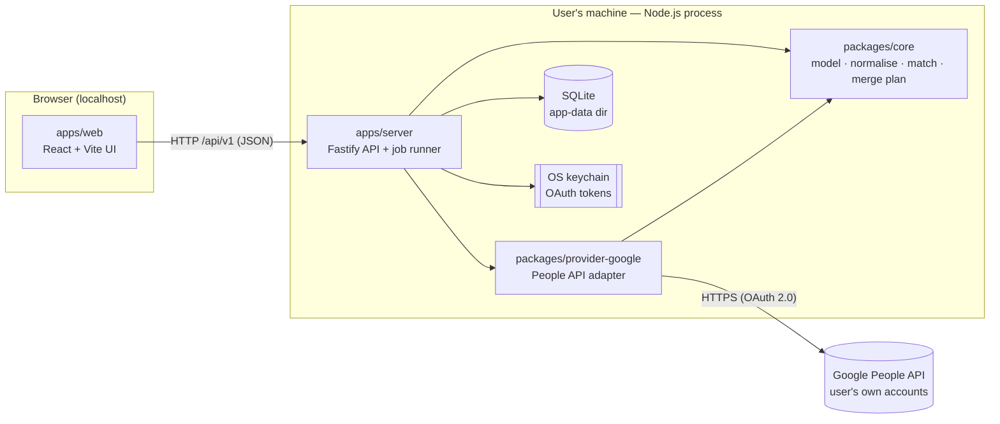
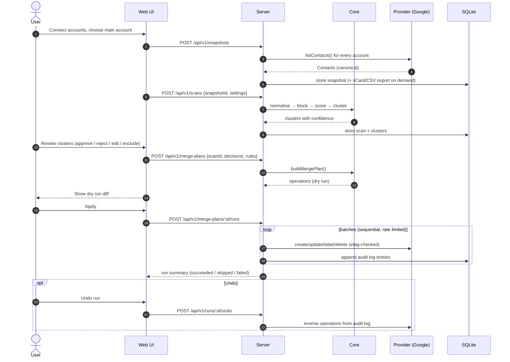

# Architecture overview

> Status: target design for v1.0. Current milestone: **M0 (foundation)**. See [roadmap](../product/roadmap.md).

contact-fuse is a **local-first web app**. One command (`npx contact-fuse`) starts a small server on the
user's own machine, bound to `127.0.0.1`, and opens the browser UI. Contacts, backups and login tokens
never leave the machine except for the direct calls to the user's own Google accounts.

## Goals and non-goals

| Goals                                                        | Non-goals (v1)                          |
| ------------------------------------------------------------ | --------------------------------------- |
| Merge contacts from many accounts into one **main account**  | Hosted / multi-tenant SaaS              |
| Safety: snapshot, dry run, explicit approval, undo           | Fully automatic merging without review  |
| Privacy: no telemetry, no third-party servers                | Mobile app                              |
| Customisable matching thresholds and merge rules             | Two-way continuous sync (planned later) |
| Provider-agnostic core (Google now, CardDAV/Microsoft later) | Contact photos (planned later)          |

## Components

| Component                  | Responsibility                                                                 | Must not                                                       |
| -------------------------- | ------------------------------------------------------------------------------ | -------------------------------------------------------------- |
| `apps/web`                 | UI: accounts, scan results, review, settings, run history                      | Talk to Google or the DB directly                              |
| `apps/server`              | HTTP API, OAuth flow, persistence, background jobs, serving the built UI       | Contain matching/merge business logic                          |
| `packages/core`            | Canonical `Contact` model, normalisation, matching, clustering, merge planning | Do any I/O (network, disk, clock, randomness must be injected) |
| `packages/provider-google` | Map Google `Person` ⇄ `Contact`, call People API, batching, rate limiting      | Make merge decisions                                           |
| SQLite                     | Snapshots, scans, clusters, plans, runs, audit log, settings                   | Store OAuth tokens                                             |
| OS keychain                | Refresh/access tokens per account                                              | —                                                              |

Package dependency rules are defined in [project-structure.md](project-structure.md#dependency-rules).

## Core flow

Details: [matching engine](matching-engine.md), [merge engine](merge-engine.md),
[provider interface](provider-interface.md), [data model](data-model.md).

## Runtime model

- **Single process.** One Node.js process serves the API and the built static UI. In development, Vite
  serves the UI on `:5173` and proxies `/api` to the server on `:4317`.
- **Jobs.** Long operations (snapshot, scan, run, undo) are in-process jobs persisted in SQLite with
  status and progress. The UI polls them (TanStack Query). A crashed run can be resumed or undone because
  every completed operation is in the audit log before the next one starts.
- **Mutations are sequential per account.** Google recommends serialising writes for one user; we never
  run parallel write batches against the same account.
- **Clock, IDs and randomness are injected** into core so tests are deterministic.

## Cross-cutting concerns

| Concern                         | Where it is defined                                                      |
| ------------------------------- | ------------------------------------------------------------------------ |
| Security, privacy, threat model | [security-and-privacy.md](security-and-privacy.md)                       |
| Errors and logging (no PII)     | [error-handling-and-logging](../standards/error-handling-and-logging.md) |
| API conventions                 | [api-design](../standards/api-design.md)                                 |
| Database conventions            | [database](../standards/database.md)                                     |
| Testing strategy                | [testing](../standards/testing.md)                                       |
| Decisions and their reasons     | [ADRs](../adr/README.md)                                                 |

## Key decisions

| ADR                                                             | Decision                                       |
| --------------------------------------------------------------- | ---------------------------------------------- |
| [0002](../adr/0002-typescript-pnpm-monorepo.md)                 | TypeScript + pnpm workspaces monorepo          |
| [0003](../adr/0003-local-first-loopback-web-app.md)             | Local-first web app on loopback                |
| [0004](../adr/0004-fastify-and-react-vite.md)                   | Fastify server, React + Vite UI                |
| [0005](../adr/0005-sqlite-with-drizzle.md)                      | SQLite with Drizzle ORM                        |
| [0006](../adr/0006-user-owned-google-oauth-client.md)           | Each user brings their own Google OAuth client |
| [0007](../adr/0007-provider-abstraction-and-canonical-model.md) | Provider abstraction + canonical contact model |
| [0008](../adr/0008-safety-first-merge-model.md)                 | Safety-first merge model                       |
