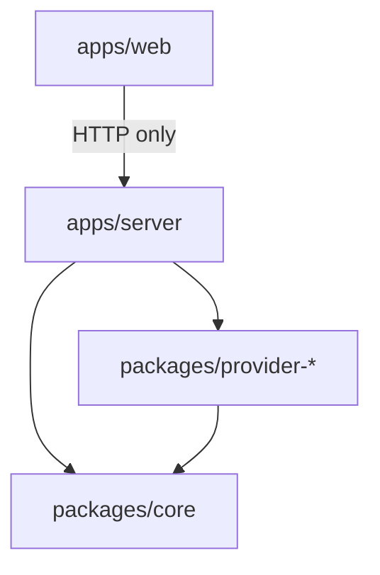

# Project structure

This is the **target v1 layout**. Folders marked _(planned)_ do not exist yet; create them when the first
file that belongs there is written. All file and folder names are kebab-case
(see [naming conventions](../standards/naming-conventions.md)).

## Directory tree

```text
contact-fuse/
├── .claude/skills/              # Project skills for AI coding agents (see CLAUDE.md)
├── .github/
│   ├── ISSUE_TEMPLATE/          # Bug / feature forms
│   ├── workflows/ci.yml         # Format, lint, typecheck, test, build
│   ├── dependabot.yml
│   └── PULL_REQUEST_TEMPLATE.md
├── .changeset/                  # (planned) Changesets release notes
├── apps/
│   ├── server/                  # @contact-fuse/server — local Fastify process
│   │   ├── drizzle/             # (planned) Generated SQL migrations — committed, never edited by hand
│   │   ├── src/
│   │   │   ├── main.ts          # Entry: load config, open DB, start server on 127.0.0.1
│   │   │   ├── app.ts           # buildApp(): registers plugins + routes (testable without listening)
│   │   │   ├── config.ts        # (planned) Env (CONTACT_FUSE_*) parsed with Zod
│   │   │   ├── errors.ts        # (planned) ContactFuseError subclasses + Fastify error handler
│   │   │   ├── plugins/         # (planned) Fastify plugins: security headers, host/origin guard, CSRF, static UI
│   │   │   ├── routes/          # (planned) One file per resource; HTTP only — parse, call service, reply
│   │   │   │   ├── accounts.ts
│   │   │   │   ├── snapshots.ts
│   │   │   │   ├── scans.ts
│   │   │   │   ├── merge-plans.ts
│   │   │   │   ├── runs.ts
│   │   │   │   └── settings.ts
│   │   │   ├── schemas/         # (planned) Zod request/response schemas shared by routes
│   │   │   ├── services/        # (planned) Use cases: orchestrate core + providers + repositories
│   │   │   │   ├── account-service.ts
│   │   │   │   ├── snapshot-service.ts
│   │   │   │   ├── scan-service.ts
│   │   │   │   ├── merge-plan-service.ts
│   │   │   │   └── run-service.ts
│   │   │   ├── jobs/            # (planned) In-process job runner, progress, resume
│   │   │   ├── auth/            # (planned) OAuth loopback + PKCE flow, keychain token store
│   │   │   ├── db/              # (planned) Drizzle schema, client, repositories
│   │   │   │   ├── schema.ts
│   │   │   │   ├── client.ts
│   │   │   │   └── repositories/
│   │   │   ├── export/          # (planned) vCard 4.0 / CSV writers
│   │   │   └── providers.ts     # (planned) Provider registry (id → ContactProvider factory)
│   │   ├── drizzle.config.ts    # (planned)
│   │   └── tsdown.config.ts
│   └── web/                     # @contact-fuse/web — React UI
│       ├── e2e/                 # (planned) Playwright *.spec.ts
│       ├── index.html
│       ├── src/
│       │   ├── main.tsx         # Entry: providers (QueryClient, router, theme)
│       │   ├── app.tsx          # Root layout + routes
│       │   ├── routes/          # (planned) One file per page: accounts, scan, review, plan, runs, settings
│       │   ├── features/        # (planned) Feature folders: UI + hooks + api calls for one domain
│       │   │   ├── accounts/
│       │   │   ├── review/
│       │   │   ├── merge-plan/
│       │   │   └── runs/
│       │   ├── components/
│       │   │   └── ui/          # (planned) shadcn/ui primitives (generated, lightly edited)
│       │   ├── hooks/           # (planned) Generic hooks not tied to a feature
│       │   ├── lib/             # (planned) api-client.ts, query keys, formatting helpers
│       │   └── styles/          # (planned) Tailwind entry + design tokens (@theme)
│       └── vite.config.ts
├── packages/
│   ├── core/                    # @contact-fuse/core — pure logic, zero I/O
│   │   └── src/
│   │       ├── index.ts         # Public API — only export what other packages need
│   │       ├── model/           # (planned) Contact, ContactRef, Match, Cluster, MergePlan types
│   │       ├── normalize/       # (planned) names, emails, phones (libphonenumber-js), dates
│   │       ├── match/           # (planned) blocking keys, scorers, weights, clustering
│   │       ├── merge/           # (planned) merge rules, survivor builder, plan builder, undo planner
│   │       ├── settings/        # (planned) Zod schema + defaults for user-tunable settings
│   │       └── testing/         # (planned) Synthetic contact factories for tests (exported via ./testing)
│   ├── provider-google/         # @contact-fuse/provider-google
│   │   └── src/
│   │       ├── index.ts
│   │       ├── google-provider.ts   # (planned) implements ContactProvider
│   │       ├── mapping.ts           # (planned) Person ⇄ Contact
│   │       ├── batching.ts          # (planned) chunking, backoff, rate limiting
│   │       └── fixtures/            # (planned) Synthetic People API JSON for MSW tests
│   └── provider-carddav/        # (planned, post-v1) iCloud and other CardDAV servers
├── docs/                        # All project documentation (index: docs/README.md)
├── CLAUDE.md / AGENTS.md        # Instructions for AI coding agents
├── README.md, CONTRIBUTING.md, CODE_OF_CONDUCT.md, SECURITY.md, CHANGELOG.md, LICENSE
├── eslint.config.js, .prettierrc.json, .editorconfig, tsconfig.base.json, vitest.config.ts
├── package.json, pnpm-workspace.yaml, pnpm-lock.yaml, .nvmrc
```

The published npm package `contact-fuse` (planned, M4) is a thin CLI that bundles the built server and
the static web UI. See [release process](../process/release-process.md).

## Where does new code go?

| You are writing…                                     | Put it in                                                                                                         |
| ---------------------------------------------------- | ----------------------------------------------------------------------------------------------------------------- |
| A rule for "are these two contacts the same person?" | `packages/core/src/match/`                                                                                        |
| How two field values combine into one                | `packages/core/src/merge/`                                                                                        |
| Cleaning up a phone/email/name                       | `packages/core/src/normalize/`                                                                                    |
| A new user-tunable setting                           | `packages/core/src/settings/` (schema + default), then UI in `apps/web/src/routes/settings`                       |
| Translating Google's JSON into a `Contact`           | `packages/provider-google/src/mapping.ts`                                                                         |
| Support for a new contact source                     | New `packages/provider-<name>/` — follow the `add-provider` skill and [provider interface](provider-interface.md) |
| A new HTTP endpoint                                  | Route in `apps/server/src/routes/`, schema in `schemas/`, logic in `services/`                                    |
| A table or column                                    | `apps/server/src/db/schema.ts` + generated migration (see [database](../standards/database.md))                   |
| Anything touching OAuth or tokens                    | `apps/server/src/auth/`                                                                                           |
| A page                                               | `apps/web/src/routes/`                                                                                            |
| UI + hooks for one domain (e.g. review)              | `apps/web/src/features/<domain>/`                                                                                 |
| A reusable visual primitive                          | `apps/web/src/components/ui/`                                                                                     |
| Synthetic test data                                  | `packages/core/src/testing/` or the provider's `fixtures/`                                                        |

## Dependency rules



1. **`core` depends on nothing** inside the repo and has no I/O dependencies (no `fs`, `http`, DB,
   `googleapis`). Allowed third-party deps are small and pure (e.g. `libphonenumber-js`, `zod`).
2. **Providers depend only on `core`** (plus their SDK). Providers never import each other or the server.
3. **`server` depends on `core` and providers.** It is the only place that composes them.
4. **`web` never imports runtime code** from other packages. It talks to the server over HTTP only.
   It may import **types** from `@contact-fuse/core` (`import type`) to share API shapes.
5. No circular imports between folders inside a package. Features in `web` do not import other features;
   shared code moves to `components/`, `hooks/` or `lib/`.

These rules are enforced in review and (planned) with ESLint `no-restricted-imports`.

## Internal package exports

Workspace packages export TypeScript source directly (`"exports": { ".": "./src/index.ts" }`). Vite and
tsx consume it as-is; `tsdown` bundles it into the server build. Packages are `private` and never
published individually.
