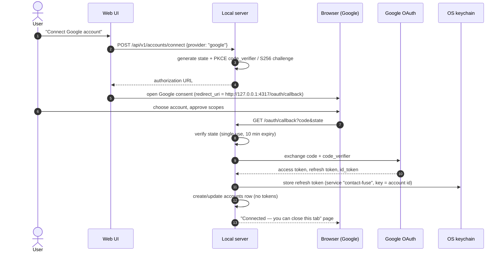

# Security and privacy

contact-fuse handles some of the most personal data people have: their address books and access to
their Google accounts. Privacy is the product's main promise
([ADR 0003](../adr/0003-local-first-loopback-web-app.md)). This document is the threat model and the
list of controls every contribution must keep intact. Report vulnerabilities as described in
[SECURITY.md](../../SECURITY.md).

## Promises to users

1. **Your data stays on your computer.** No contact-fuse server exists. The only network traffic is
   between your machine and your own Google accounts (and npm when installing).
2. **No telemetry, analytics or crash reporting.** Not even opt-in in v1.
3. **No remote assets.** The UI loads no fonts, scripts, images or CSS from the internet.
4. **Least privilege.** Only the scopes needed for the features you enable.
5. **You can delete everything** from the app, in one action.

## Assets

| Asset                               | Where                                                            | Sensitivity                                                                              |
| ----------------------------------- | ---------------------------------------------------------------- | ---------------------------------------------------------------------------------------- |
| OAuth refresh/access tokens         | OS keychain                                                      | Critical — full contacts access                                                          |
| OAuth client ID/secret (user-owned) | Client ID in SQLite `settings`; client secret in the OS keychain | Medium (installed-app secrets are not truly secret, but must not be committed or logged) |
| Contacts, snapshots, audit log      | SQLite in app-data dir                                           | High — PII                                                                               |
| Exported vCard/CSV backups          | Location the user chooses                                        | High — PII                                                                               |
| Logs                                | stdout / app-data `logs/`                                        | Must contain **no** PII                                                                  |

## Threat model (STRIDE-lite)

| Threat                     | Example                                                                          | Controls                                                                                                                                                                                                                                    |
| -------------------------- | -------------------------------------------------------------------------------- | ------------------------------------------------------------------------------------------------------------------------------------------------------------------------------------------------------------------------------------------- |
| **Spoofing**               | Malicious website in the user's browser calls `http://127.0.0.1:4317/api/v1/...` | Loopback bind; **Host header allowlist** (`127.0.0.1:<port>`, `localhost:<port>`) defeats DNS rebinding; **Origin check** on every non-GET; **CSRF token** (per-session, double-submit, `SameSite=Strict` cookie + header); no CORS headers |
| **Tampering**              | Attacker modifies local DB or plan between dry run and apply                     | Plans are re-validated before execution; every write is etag-checked against the provider; app-data dir created with `0700`, DB file `0600`                                                                                                 |
| **Repudiation**            | "What did the tool do to my contacts?"                                           | Append-only audit log per run, visible in the UI and exportable                                                                                                                                                                             |
| **Information disclosure** | Contacts leak via logs, error reports, screenshots in issues, or a LAN listener  | PII-free structured logs with redaction; masked values in UI reasons; server never binds to `0.0.0.0`; issue templates warn against pasting contact data; no telemetry                                                                      |
| **Information disclosure** | OAuth tokens stolen from disk                                                    | Tokens only in OS keychain (`@napi-rs/keyring`); never in SQLite, env files or logs                                                                                                                                                         |
| **Denial of service**      | Runaway batch hits Google quota                                                  | Sequential writes, rate limiter, backoff, pause/resume                                                                                                                                                                                      |
| **Elevation of privilege** | Supply-chain attack via a dependency                                             | Lockfile committed; pnpm blocks dependency build scripts unless approved; Dependabot; minimal deps in `core`; npm provenance on publish (see [dependencies](../standards/dependencies.md))                                                  |
| **Destructive bug**        | Engine merges two different people and deletes one                               | Snapshot first, dry run, Medium never preselected, deletes opt-in and confirmed twice, undo (see [merge engine](merge-engine.md))                                                                                                           |

## Local server hardening

- Bind **only** to `127.0.0.1` (IPv4 loopback). Port `4317` by default (`CONTACT_FUSE_PORT`); if busy,
  pick a free port and print the URL.
- Reject requests whose `Host` is not an allowed loopback host:port → `403`.
- Reject state-changing requests (`POST`, `PUT`, `PATCH`, `DELETE`) without a matching `Origin` and CSRF
  token → `403`.
- Security headers on every response: strict `Content-Security-Policy` (`default-src 'self'`;
  `connect-src 'self'`; `img-src 'self' data:`; `frame-ancestors 'none'`), `X-Content-Type-Options:
nosniff`, `Referrer-Policy: no-referrer`, `Cross-Origin-Opener-Policy: same-origin`.
- The browser is opened with a one-time launch token in the URL fragment to bind the first session.
- Request bodies are size-limited and validated with Zod.

## OAuth

contact-fuse is a native/installed app per [RFC 8252](https://www.rfc-editor.org/rfc/rfc8252):

- **Client:** each user creates their own _Desktop app_ OAuth client
  ([ADR 0006](../adr/0006-user-owned-google-oauth-client.md),
  [setup guide](../guides/google-cloud-setup.md)).
- **Scopes (least privilege, growing with features):**
  - Connect, back up and scan (M1–M2): `openid email` (to identify the account) and
    `contacts.readonly`.
  - `contacts.other.readonly` **only** if the user enables "Include Other contacts".
  - `contacts` (read/write) is requested with incremental authorisation **only when the user first
    applies a merge** (M3), for the main account and any account with a non-`keep` cleanup policy.
  - If the user unticks the contacts box on Google's consent screen, the connection is refused with
    `PROVIDER_PERMISSION_DENIED` and nothing is stored.
- **State and PKCE:** `state` is 32 random bytes, single use and expires after 10 minutes; the PKCE
  verifier never leaves the server. `prompt=consent` makes Google return a refresh token on every
  connect, including reconnects.
- **ID token:** received directly from Google's token endpoint over TLS, so per OpenID Connect Core
  §3.1.3.7 the signature check is skipped; `aud` (our client ID), `iss`, `exp` and `email_verified`
  are still checked. The account is identified by `sub`, so a changed email reconnects the same
  account.
- **Keychain entries:** service `contact-fuse`, keys `refresh-token:<accountId>` and
  `google-oauth-client-secret`.
- **Testing-mode limits:** an unverified app in _Testing_ status allows **up to 100 test users** per
  OAuth client, and **refresh tokens expire after 7 days**. The UI shows "Reconnect needed" when this
  happens (`TOKEN_EXPIRED`); runs pause instead of failing.
- **Disconnect** revokes the token at Google and deletes it from the keychain.

## Data at rest

- App-data directory created with permissions `0700`; SQLite file `0600`.
- SQLite is **not encrypted** in v1. Rationale: the OS user account and full-disk encryption (FileVault,
  BitLocker, LUKS) are the protection boundary; encrypting with a key stored on the same machine adds
  little. Documented for users; revisit with SQLCipher if requested.
- Exports are written only where the user chooses, with a warning that they contain personal data.

## Retention and deletion

- Snapshots and runs are kept until the user deletes them. Default: keep the last **10** snapshots;
  older ones are pruned only if they are not referenced by an undoable run (setting).
- **Settings → Delete all local data** disconnects every account (revokes + deletes keychain entries)
  and deletes the app-data directory.
- Uninstalling the npm package does not delete data; the docs and the CLI (`contact-fuse --delete-data`)
  explain how.

## Logging rules

Never log: names, emails, phone numbers, notes, raw provider payloads, tokens, auth codes, client
secrets. Log: IDs, counts, durations, error codes. pino redaction paths are configured centrally as a
second line of defence. Full rules: [error handling and logging](../standards/error-handling-and-logging.md).

## Security checklist for PRs

- [ ] No new network destinations other than the provider APIs.
- [ ] No PII or secrets in logs, errors, test fixtures or snapshots (synthetic data only).
- [ ] New endpoints validated with Zod and covered by Host/Origin/CSRF guards.
- [ ] New scopes justified in an ADR.
- [ ] Destructive operations go through plan → dry run → confirmation → audit log.
