# User flows

The main journeys through contact-fuse. Screen names in **bold** match the UI. Terms follow the [glossary](glossary.md). Screen design rules are in the [UI guidelines](../design/ui-guidelines.md).

## Overview

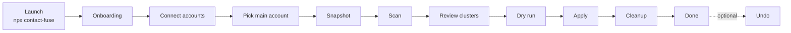

Every step before **Apply** is read-only for Google.

---

## 1. Launch and onboarding

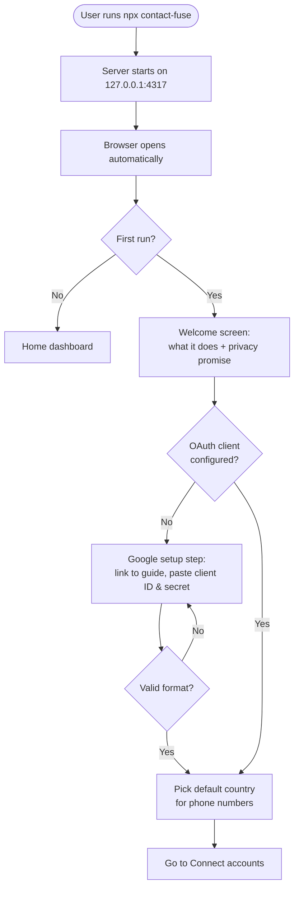

- The privacy promise is shown before any sign-in: _"Your contacts stay on this computer."_
- The client secret is stored in the OS keychain, never shown again in full.

## 2. Connect accounts

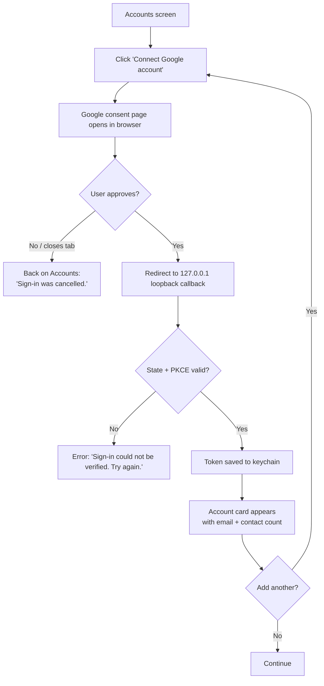

- Connecting the same account twice updates the existing account instead of duplicating it.
- At least **2 accounts** are recommended. One account is allowed (in-account de-duplication).

## 3. Pick main account

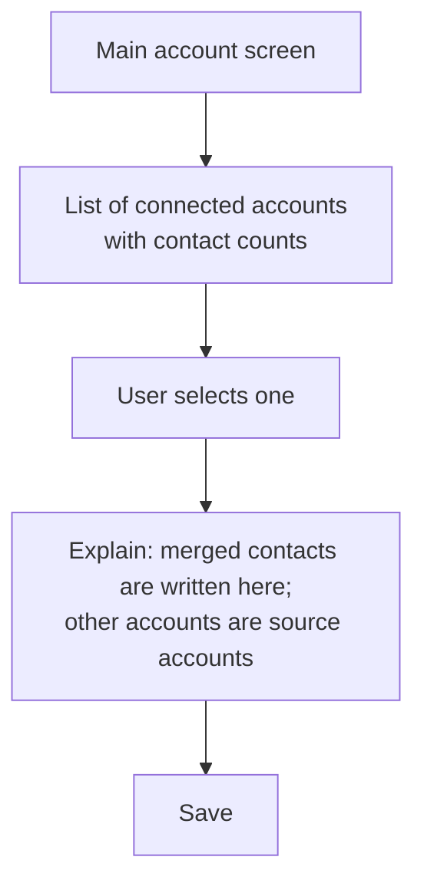

The main account can be changed at any time before a run. Changing it invalidates any existing merge plan.

## 4. Snapshot (backup)

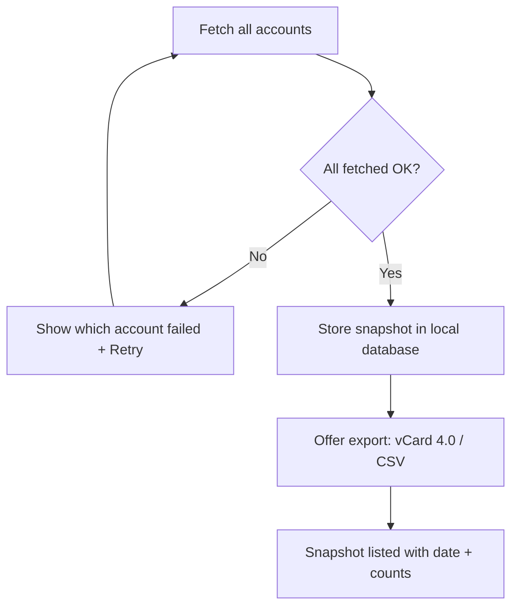

- A snapshot is taken automatically on the first fetch and **always** right before a run.
- Snapshots are listed under **Backups** and can be exported or deleted.

## 5. Scan

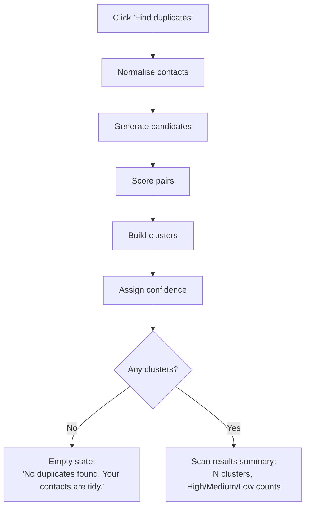

Progress is shown as a determinate bar with the current stage name. A scan can be cancelled.

## 6. Review clusters

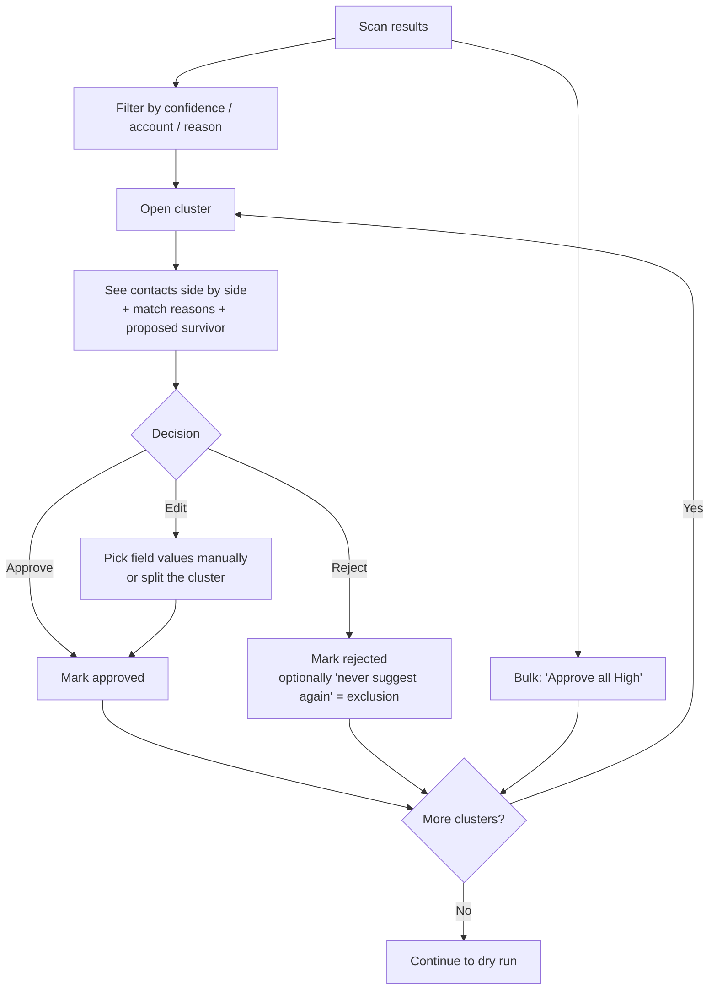

- High clusters are **preselected**, not approved. The user still confirms them, individually or in bulk.
- Medium clusters require an explicit decision. Low clusters are hidden unless "Show low confidence" is on.

## 7. Settings and merge rules

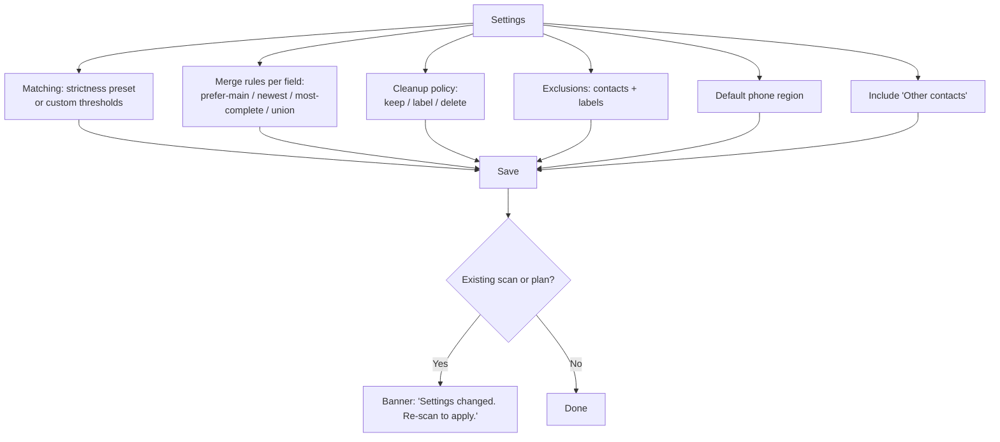

## 8. Dry run

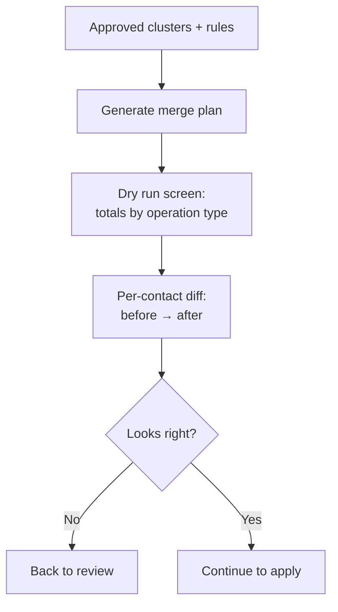

The dry run shows, in order: contacts **created** in the main account, contacts **updated** in the main account, and what happens to source contacts under the cleanup policy.

## 9. Apply

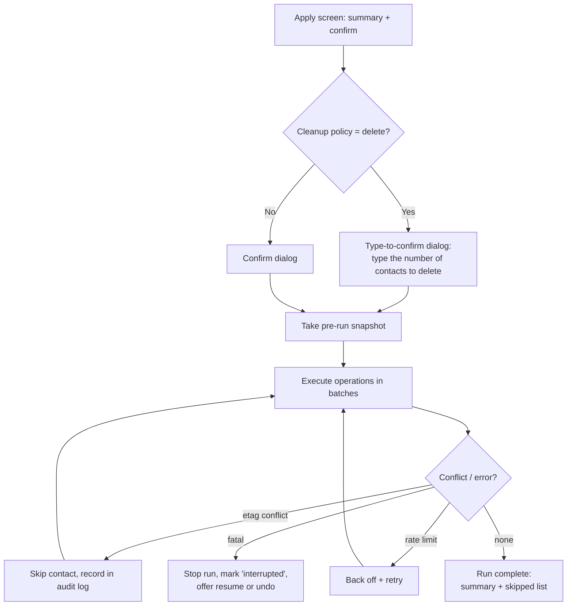

Users must not close the browser tab during a run, though closing it does not break anything because the run executes on the server. Reopening the app shows the run's progress.

## 10. Cleanup (source accounts)

Cleanup is part of the run and follows the cleanup policy:

| Policy           | Effect on merged source contacts                                                         |
| ---------------- | ---------------------------------------------------------------------------------------- |
| `keep` (default) | Untouched                                                                                |
| `label`          | Added to a "Merged by contact-fuse" label so the user can review them in Google Contacts |
| `delete`         | Deleted from the source account (requires type-to-confirm; restorable by undo)           |

## 11. Undo

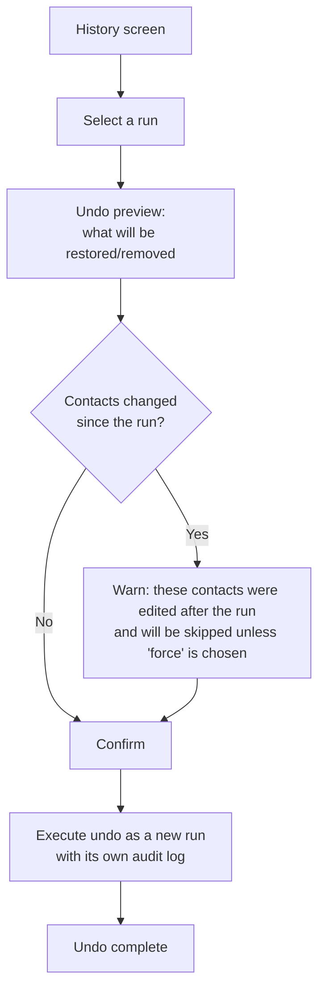

Undo itself is a run, so it is recorded and can in turn be undone.

## 12. Export

From **Backups**: choose a snapshot → choose a format (vCard 4.0 or CSV) → choose the accounts (all or some) → the browser downloads the file. Exports are generated locally. A notice reminds the user the file contains personal data.

## 13. Disconnect and delete local data

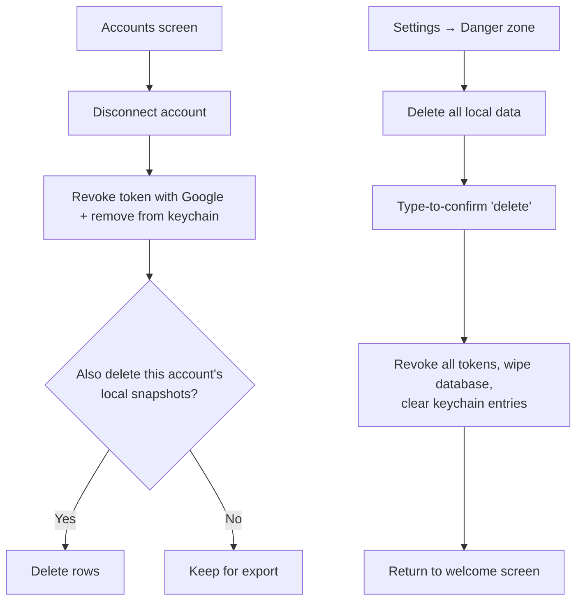

Disconnecting never deletes anything in Google.
